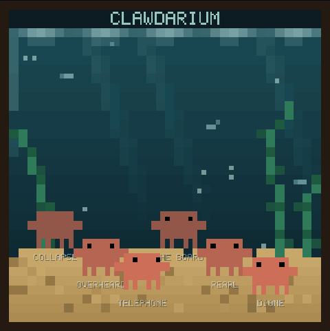
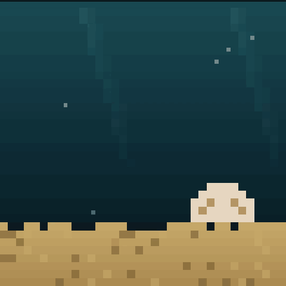
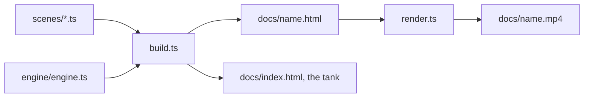

```
  ██████╗██╗      █████╗ ██╗    ██╗██████╗
 ██╔════╝██║     ██╔══██╗██║    ██║██╔══██╗
 ██║     ██║     ███████║██║ █╗ ██║██║  ██║
 ██║     ██║     ██╔══██║██║███╗██║██║  ██║
 ╚██████╗███████╗██║  ██║╚███╔███╔╝██████╔╝
  ╚═════╝╚══════╝╚═╝  ╚═╝ ╚══╝╚══╝ ╚═════╝
  █████╗ ██████╗ ██╗██╗   ██╗███╗   ███╗
 ██╔══██╗██╔══██╗██║██║   ██║████╗ ████║
 ███████║██████╔╝██║██║   ██║██╔████╔██║
 ██╔══██║██╔══██╗██║██║   ██║██║╚██╔╝██║
 ██║  ██║██║  ██║██║╚██████╔╝██║ ╚═╝ ██║
 ╚═╝  ╚═╝╚═╝  ╚═╝╚═╝ ╚═════╝ ╚═╝     ╚═╝
```

<div align="center">

### `AN AQUARIUM FOR CLAWD // EVERY ANIMATION IS A CRAB`

*a pixel animation engine, its scenes, and the live tank they all swim in*


-111111?style=flat-square&labelColor=111111)

</div>

---

## 🐚 What is this

Clawdarium is where Clawd animations live. Each one is a TypeScript scene on a
shared pixel engine (36×36 grid, 1080×1080 canvas, 24fps, the canonical 14×8
crab sprite), and each one compiles to a self-contained HTML file you can open
anywhere plus an MP4 you can send anyone. `render(f)` is a pure function of
the frame number, so the capture script can pull frame 140 before frame 3 and
nobody notices.

The front door is the tank: a live pixel aquarium where every scene is a crab
wandering the sand. Hover a crab and its name comes up. Click it and its clip
plays. Scenes in `scenes/private/` build and render locally but never reach
GitHub, which is why the public tank is one crab short.

```console
nick@clawdarium:~$ bun serve.ts
clawdarium swimming at http://localhost:4550
[i] 5 crabs in the tank. one of them is not on github.
```

## 🦀 The tank

| | part | what it actually does |
|---|---|---|
| 01 | **engine/engine.ts** | the whole API: grid drawing, seeded rnd, easing, the clawd sprite, eye variants, a 5×9 pixel font. no fillText, no anti-aliasing, no mouth |
| 02 | **scenes/*.ts** | one file per animation. imports the engine, ends with `run(scene)`. shared props live in subfolders |
| 03 | **scenes/private/** | gitignored scenes for animations with names in them: built and rendered locally, absent from the public tank |
| 04 | **build.ts** | bundles every scene into a self-contained `docs/<name>.html` and generates the tank at `docs/index.html` |
| 05 | **render.ts** | replays each scene frame by frame in the playwright headless shell, then ffmpeg stitches the mp4 |
| 06 | **docs/** | committed and served by github pages from main. no ci, the deploy step is `git push` |

## 📸 Evidence



*the tank, live. six crabs locally, five on pages.*



*the pearl scene: 168 deterministic frames, rendered in any order.*

## 🚀 Run it

Needs [bun](https://bun.sh), ffmpeg, and the playwright headless shell for rendering.

```bash
git clone https://github.com/nitrimandylis/clawdarium.git
cd clawdarium
bun install
bun run build     # scenes + tank → docs/
bun run render    # docs/<name>.mp4, deterministically
bun run serve     # http://localhost:4550
```

The tank fills itself from `manifest.json`: add a scene file, rebuild, and
there is one more crab.

## 🔩 Under the hood



| layer | path | job |
|---|---|---|
| engine | `engine/engine.ts` | drawing, timing, sprite, font, the capture contract |
| scenes | `scenes/` | the animations: pure `render(f)`, no state between frames |
| hub | `hub/` | the aquarium page: wandering crabs, hover tags, overlay clips |
| pipeline | `build.ts` · `render.ts` · `serve.ts` | ts → html → mp4 → localhost |

**Stack:** typescript · bun · canvas 2d · playwright-core · ffmpeg

---

<div align="center">

**[Nick Trimandylis](https://github.com/nitrimandylis)**

`NO MOUTH. THE EYES DO THE ACTING`

MIT licensed.

</div>
